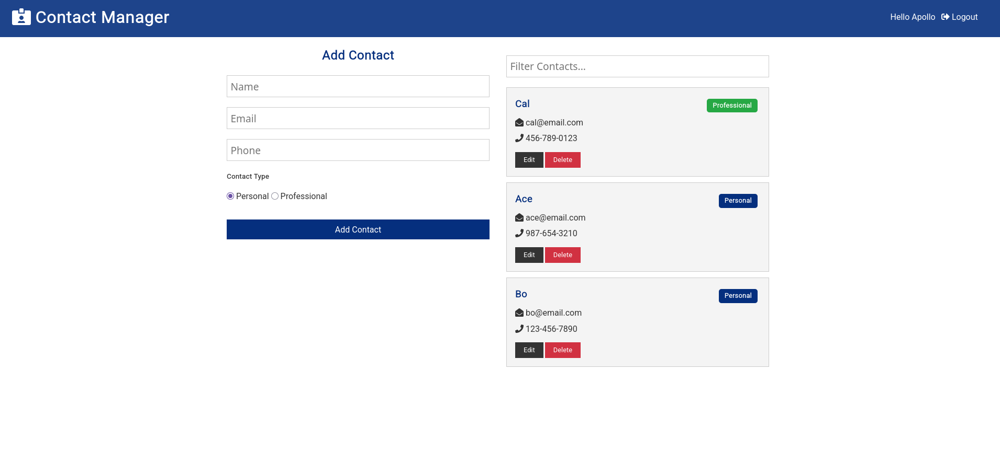
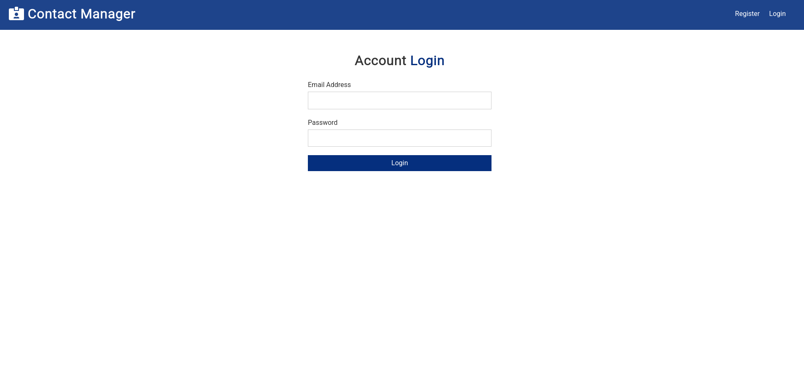
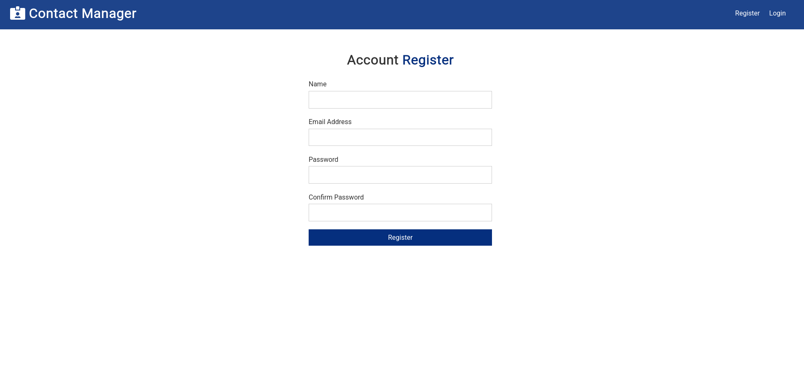

# Contact Manager

A full stack MERN app (MongoDB, Express, React, Node) for keeping a private list of contacts. Users sign up, log in, and can add, edit, delete and search their own contacts. Nobody else can see or change them.



## Features

- Register and log in with JWT authentication. Passwords are hashed with bcrypt.
- Add, edit and delete contacts, saved in MongoDB
- Tag contacts as personal or professional
- Live search by name or email
- Protected API routes and protected pages, plus a server-side check that users can only change their own contacts

<p>
  
  
</p>

## Tech Stack

- **Frontend:** React (hooks, Context API + useReducer), React Router, Axios
- **Backend:** Node.js, Express, express-validator
- **Database:** MongoDB with Mongoose
- **Auth:** JSON Web Tokens, bcryptjs

## How It Works

- The React app calls the Express API with Axios. After login, it sends the JWT in an `x-auth-token` header on every request.
- An auth middleware verifies the token and attaches the user's id to the request before any private route runs.
- Every contact is stored with its owner's id. The API only returns your contacts, and it checks ownership before an update or delete.

## Getting Started

You'll need Node 16 (`nvm use` reads it from `.nvmrc`) and a MongoDB database, such as a free Atlas cluster.

```bash
git clone https://github.com/acreyes311/contact-manager.git
cd contact-manager
npm install && npm run clientinstall

cp .env.example .env                               # add your MongoDB connection string
cp config/default.example.json config/default.json  # add a long random jwtSecret

npm run dev    # API on :5000, React on :3000
```

## API

| Method | Endpoint            | Access  | Description               |
| ------ | ------------------- | ------- | ------------------------- |
| POST   | `/api/users`        | Public  | Register, returns a token |
| POST   | `/api/auth`         | Public  | Log in, returns a token   |
| GET    | `/api/auth`         | Private | Get the logged in user    |
| GET    | `/api/contacts`     | Private | Get your contacts         |
| POST   | `/api/contacts`     | Private | Add a contact             |
| PUT    | `/api/contacts/:id` | Private | Update your contact       |
| DELETE | `/api/contacts/:id` | Private | Delete your contact       |
